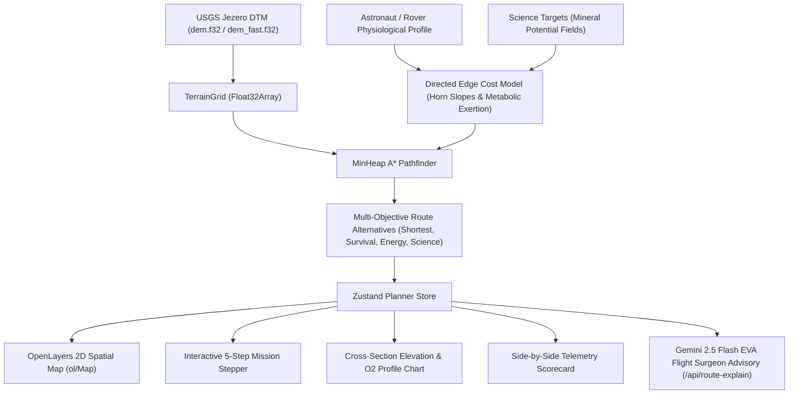
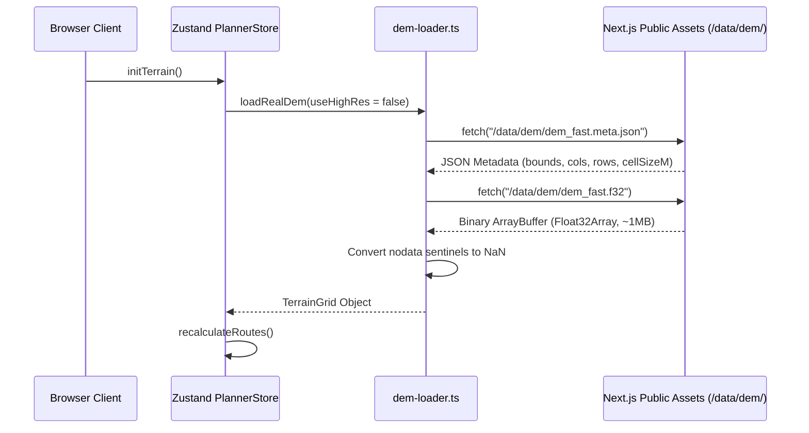
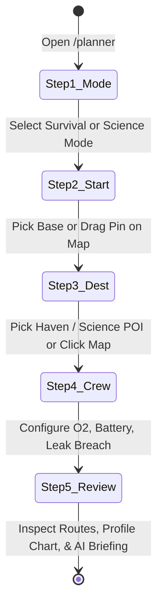

# Project Astra — Planner Module: Architecture & Context Specification

> **NASA Space Apps Challenge 2026** — *Interplanetary Survival Guide: Martian Map*  
> **Workspace:** Martian Route Planner (`/planner`)  
> **Target Region:** Jezero Crater, Mars ($18.38^\circ\text{N} - 18.55^\circ\text{N}$, $77.20^\circ\text{E} - 77.58^\circ\text{E}$)  
> **Scientific Classification:** Multi-Tier Spatial Decision Support (**OBSERVED** USGS DTM, **DERIVED** Horn Slopes, **MODELLED** Metabolic Traversal)

---

## 1. Executive Summary & Purpose

The **Planner Module** (`frontend/app/planner`) is a core spatial workspace within Project Astra. It provides an interactive, mathematically rigorous, and scientifically grounded route-planning engine designed for surface extravehicular activities (EVA) and autonomous rover transit across **Jezero Crater, Mars**.



### Key Capabilities
1. **Real Mars Elevation Ingestion:** Ingests binary IEEE-754 `Float32Array` elevation rasters derived directly from USGS Astrogeology / NASA MRO CTX stereo DTMs (60m and 20m spatial resolution).
2. **Multi-Objective Graph Optimization:** Computes four simultaneous comparative routing strategies using an 8-connected grid search powered by a custom binary `MinHeap` priority queue:
   - **Euclidean Shortest Path (`shortest`):** Pure distance minimization without slope penalties (reveals delta scarp hazards).
   - **Astronaut Survival Route (`survival`):** Balances planar distance with non-linear metabolic cost, routing through natural ramp gradients.
   - **Minimum Energy / Battery Route (`energy`):** Aggressively minimizes grade climbing to preserve suit life-support electrical reserves.
   - **Science-Maximized Route (`science`):** Dynamically attracts trajectories into ancient deltaic smectite clays and carbonate mineral deposits via radial potential fields.
3. **Biomechanical & Physiological Consumable Modeling:** Models human locomotion and suit mechanics under Martian gravity ($g_{\text{mars}} = 3.721\text{ m/s}^2$), calculating instantaneous speed, metabolic oxygen consumption rate, suit power draw, hypoxia probability, and catastrophic rollover risk.
4. **Interactive Spatial Map & Stepper UI:** Built on OpenLayers (`ol`), providing interactive drag-and-drop waypoint markers, slope-colored polyline segments, an animated rover beacon, cross-section elevation charts, and a 5-step guided EVA wizard.
5. **AI Flight Surgeon Advisory:** Connects to a server-side Next.js Route Handler querying Google Gemini 2.5 Flash with deterministic telemetry to deliver concise tactical briefings for crew members on the ground.

---

## 2. Scientific Provenance & Architecture Boundaries

In strict compliance with [AGENTS.md](file:///home/sunyacore/workspace/HACKATHON_PROJECTS/astra-project/martian-map-project-astra/AGENTS.md):

| Data / Component | Data Classification | Provenance & Source | Limitations & Boundary |
| :--- | :--- | :--- | :--- |
| **Topography (Elevation)** | **OBSERVED** | USGS Astrogeology Science Center / NASA Mars Reconnaissance Orbiter (MRO) CTX Stereo DTM (`JEZ_CTX_DTM`) | Mars Aeroid vertical datum; 20m & 60m cell spacing; no-data voids converted to `NaN`. |
| **Surface Slopes** | **DERIVED** | Horn's 3×3 weighted finite-difference algorithm computed from local DTM cells | Approximates macro-topography; sub-grid boulders (<20m) and regolith micro-roughness are not resolved. |
| **Metabolic Traversal** | **MODELLED** | Margaria-Minetti walking work equation adapted for Martian gravity ($3.721\text{ m/s}^2$) | Theoretical bioenergetic model; assumes pressurized EVA suit mass (110 kg) and standard astronaut physical fitness. |
| **Mineral Fields** | **OBSERVED / MODELLED** | NASA Mars 2020 Perseverance science team crater deposits (CRISM / SuperCam spectral detections) | Synthesized radial potential field for demonstration; not an operational sample retrieval schedule. |
| **System Classification** | **PROTOTYPE** | Educational & Decision-Support System | **NON-OPERATIONAL:** Not certified for flight operations, astronaut safety, or real-time rover auto-navigation. |

---

## 3. System Architecture & Component Hierarchy

The planner module follows a clean, decoupled layer architecture:

```text
frontend/
├── app/
│   ├── planner/
│   │   └── page.tsx                     # Top-level workspace layout & telemetry drawer
│   └── api/
│       └── route-explain/
│           └── route.ts                 # Gemini 2.5 Flash EVA Flight Surgeon API
├── components/
│   └── planner/
│       ├── PlannerMap.tsx               # OpenLayers 2D map canvas & vector overlays
│       ├── PlannerStepper.tsx           # 5-step interactive mission setup wizard
│       ├── ElevationChart.tsx           # Cross-section elevation profile & O2 timeline
│       ├── RouteComparisonTable.tsx     # Side-by-side numerical telemetry scorecard
│       ├── AiAdvisoryBriefing.tsx       # AI Flight Surgeon report card
│       ├── AstronautSurvivalPanel.tsx   # Consumables, telemetry, & hypoxia indicators
│       └── ScienceMissionPanel.tsx      # Science objectives & mineral potential rankings
└── lib/
    ├── domain/                          # Framework-agnostic pure algorithmic core
    │   ├── types.ts                     # TypeScript data interfaces & contracts
    │   ├── dem-loader.ts                # Binary IEEE-754 Float32Array DTM loader
    │   ├── terrain-grid.ts              # Equirectangular spatial transforms & Horn slopes
    │   ├── mars-math.ts                 # Mars geodesic distance & edge slope trigonometry
    │   ├── cost-model.ts                # Directed edge cost functions per strategy
    │   ├── survival-model.ts            # Physiological EVA consumable integration
    │   ├── science-targets.ts           # Predefined Jezero POIs & greedy ranking
    │   ├── pathfinder.ts                # MinHeap priority queue & multi-objective A*
    │   └── sim-terrain.ts               # Synthetic fallback terrain generator
    ├── state/
    │   └── planner-store.ts             # Centralized Zustand reactive state machine
    └── map/
        ├── mars-projection.ts           # IAU Mars 2000 Equirectangular projection
        └── layer-factory.ts             # OpenLayers WMTS/XYZ layer builder
```

---

## 4. Domain Model & Mathematical Formulations

### 4.1. Mars Spatial Reference & Coordinate Systems
The Martian radius differs significantly from Earth. Calculations in [mars-math.ts](file:///home/sunyacore/workspace/HACKATHON_PROJECTS/astra-project/martian-map-project-astra/frontend/lib/domain/mars-math.ts) use the IAU Mars 2000 reference sphere:
- **Equatorial Radius ($R_{\text{mars}}$):** $3,396,190\text{ m}$ ($3,396.19\text{ km}$)
- **Degrees to Metres ($M_{\text{per deg}}$):** $\frac{\pi \cdot R_{\text{mars}}}{180} \approx 59,274.6975\text{ m/deg}$
- **Geodesic Distance:** Equirectangular approximation accounting for latitude compression:
  $$d(\mathbf{p}_1, \mathbf{p}_2) = R_{\text{mars}} \cdot \sqrt{(\Delta \phi)^2 + \left(\cos\left(\frac{\phi_1 + \phi_2}{2}\right) \cdot \Delta \lambda\right)^2}$$

### 4.2. Horn's 3×3 Surface Slope Algorithm
Slopes are calculated in [terrain-grid.ts](file:///home/sunyacore/workspace/HACKATHON_PROJECTS/astra-project/martian-map-project-astra/frontend/lib/domain/terrain-grid.ts) from the 8 neighboring cells of elevation matrix $Z$:
$$\begin{matrix} z_1 & z_2 & z_3 \\ z_4 & z_{\text{center}} & z_6 \\ z_7 & z_8 & z_9 \end{matrix}$$

Accounting for latitude-dependent east-west cell spacing $\Delta x = \Delta \lambda \cdot M_{\text{per deg}} \cdot \cos(\phi)$ and north-south cell spacing $\Delta y = \Delta \phi \cdot M_{\text{per deg}}$:
$$\frac{\partial z}{\partial x} = \frac{(z_3 + 2z_6 + z_9) - (z_1 + 2z_4 + z_7)}{8 \cdot \Delta x}$$
$$\frac{\partial z}{\partial y} = \frac{(z_1 + 2z_2 + z_3) - (z_7 + 2z_8 + z_9)}{8 \cdot \Delta y}$$
$$\theta_{\text{slope}} = \arctan\left(\sqrt{\left(\frac{\partial z}{\partial x}\right)^2 + \left(\frac{\partial z}{\partial y}\right)^2}\right) \cdot \frac{180^\circ}{\pi}$$

### 4.3. Multi-Objective Cost Functions
For a directed step of planar distance $d$ and elevation delta $\Delta z = z_{\text{next}} - z_{\text{cur}}$, the directed edge slope angle is $\theta = \arctan(|\Delta z| / d) \cdot \frac{180}{\pi}$.
If $\theta > \theta_{\text{limit}}$ ($22^\circ$ default), the step cost is $\infty$ (impassable cliff/rollover constraint). Otherwise, the step cost $C$ is computed in [cost-model.ts](file:///home/sunyacore/workspace/HACKATHON_PROJECTS/astra-project/martian-map-project-astra/frontend/lib/domain/cost-model.ts):

1. **Shortest Strategy:**
   $$C_{\text{shortest}} = d$$
2. **Survival Strategy:**
   $$S = \frac{\theta}{\theta_{\text{comfort}}}, \quad G_{\text{up}} = \max\left(0, \frac{\Delta z}{d}\right)$$
   $$C_{\text{survival}} = d \cdot \left(1.0 + 5.0 \cdot \left(S^{2.2} + 4.0 \cdot G_{\text{up}}\right)\right)$$
3. **Energy Strategy:**
   $$C_{\text{energy}} = d \cdot \left(1.0 + 8.5 \cdot \left(S^{2.8} + 6.5 \cdot G_{\text{up}}\right)\right)$$
4. **Science Strategy:**
   $$C_{\text{science}} = d \cdot \left(1.0 + 4.5 \cdot \left(S^{2.0} + 3.5 \cdot G_{\text{up}}\right)\right) \cdot \max(0.25, A_{\text{science}})$$
   Where $A_{\text{science}} \in [0.35, 1.0]$ is the potential field discount generated by nearby mineral targets.

### 4.4. Physiological EVA Consumable Model
Implemented in [survival-model.ts](file:///home/sunyacore/workspace/HACKATHON_PROJECTS/astra-project/martian-map-project-astra/frontend/lib/domain/survival-model.ts):
- **Martian Walking Velocity:**
  $$v_{\text{uphill}}(\theta) = v_0 \cdot \max\left(0.12, 1.0 - \left(\frac{\theta}{24}\right)^{1.4}\right)$$
  $$v_{\text{downhill}}(\theta) = \begin{cases} v_0 \cdot 0.95 & \text{if } \theta \le 15^\circ \\ v_0 \cdot \max(0.3, 1.0 - (\theta - 15) \cdot 0.05) & \text{if } \theta > 15^\circ \end{cases}$$
- **Instantaneous Oxygen Burn Rate:**
  $$\dot{V}_{O_2} = \dot{V}_{O_2,\text{base}} \cdot \left(1.0 + 2.8 \sin(\theta) \cdot \frac{\theta}{10}\right) + \dot{V}_{\text{leak}}$$
- **Power & Energy Expenditure:**
  $$P_{\text{locomotion}} = (m_{\text{suit}} + m_{\text{body}}) \cdot g_{\text{mars}} \cdot v \cdot (0.28 + 1.8 \sin(\theta))$$
  $$P_{\text{total}} = P_{\text{locomotion}} + 120\text{ W (Suit Life Support Baseline)}$$
- **Survival Probability Metric:**
  Evaluates three independent mission-failure modes:
  1. *Oxygen Depletion:* If $O_{2,\text{remain}} \le 0 \implies P = 0$. If $O_{2,\text{remain}} < 15\text{ L} \implies P \gets P \cdot \frac{O_{2,\text{remain}}}{15}$.
  2. *Scarp Rollover Hazard:* For $N$ segments exceeding $\theta_{\text{limit}}$, $P \gets P \cdot (0.85)^N$.
  3. *Battery Exhaustion:* If battery drops to $0\text{ Wh} \implies P \gets P \cdot 0.30$.

---

## 5. USGS DTM Binary Ingestion Pipeline

To provide instantaneous pathfinding directly in the browser without server roundtrips, the planner uses pre-compiled binary floating-point arrays:



### Dataset Specifications
- **Fast DTM (`dem_fast.f32`):**
  - Dimensions: $667 \times 500$ cells ($333,500$ nodes)
  - Grid Spacing: $60\text{ m}$
  - Memory Footprint: $\approx 1.33\text{ MB}$
  - Search Time: $\approx 8\text{ ms} - 15\text{ ms}$
- **High-Res DTM (`dem.f32`):**
  - Dimensions: $2000 \times 1500$ cells ($3,000,000$ nodes)
  - Grid Spacing: $20\text{ m}$
  - Memory Footprint: $\approx 12.0\text{ MB}$

---

## 6. Reactive State Architecture (`planner-store.ts`)

State is managed via [planner-store.ts](file:///home/sunyacore/workspace/HACKATHON_PROJECTS/astra-project/martian-map-project-astra/frontend/lib/state/planner-store.ts), linking UI wizard steps to pathfinder computations and OpenLayers rendering.

### State Slice Definition
```typescript
interface PlannerState {
  currentStep: 1 | 2 | 3 | 4 | 5;
  mode: 'survival' | 'science';
  astronaut: AstronautProfile;
  terrain: {
    grid: TerrainGrid | null;
    status: 'idle' | 'loading' | 'ready' | 'error';
    note: string;
  };
  startPoint: LonLat;
  destinationPoint: LonLat;
  selectedStartPresetId: string | null;
  selectedHavenPresetId: string | null;
  scienceTargets: ScienceObjective[];
  selectedTargetId: string | null;
  pickMode: 'start' | 'destination' | null;
  routes: Record<Strategy, RouteResult> | null;
  activeStrategy: Strategy;
  isCalculating: boolean;
  calculationError: string | null;
  aiBriefing: string | null;
  isGeneratingAi: boolean;
  roverProgress: number; // 0 to 1 along active route
}
```

### The 5-Step Guided Mission Workflow


1. **Step 1: Mission Mode:** Toggle between `Astronaut Emergency Survival` (evacuation to refuge shelter) and `Scientific Exploration` (crater mineral sampling).
2. **Step 2: Start Location:** Choose from presets (e.g., Octavia E. Butler Landing, Nili Planum Outpost) or activate map-picker mode to place pin on OpenLayers canvas.
3. **Step 3: Destination Site:** Select target haven (Western Delta Refuge, Kodiak Shelter) or high-priority mineral outcrop.
4. **Step 4: Crew & Constraints:** Adjust remaining oxygen liters, battery percentage, suit mass, and toggle real-time emergency suit pressure breach ($1.2\text{ L/min}$ leak).
5. **Step 5: Review & AI Advisory:** Side-by-side scorecard comparison, cross-section elevation profile, and one-click NASA EVA Flight Surgeon report generation.

---

## 7. OpenLayers 2D Spatial Map Integration

Implemented in [PlannerMap.tsx](file:///home/sunyacore/workspace/HACKATHON_PROJECTS/astra-project/martian-map-project-astra/frontend/components/planner/PlannerMap.tsx):

### Layer Stacking Order (Z-Index Hierarchy)
1. **Basemap Layer (`zIndex: 0`):** NASA Mars Trek WMTS / USGS CTX Jezero Mosaic ($6\text{ m/px}$), MOLA Elevation Colorized Shaded Relief, or Viking MDIM 2.1 global context.
2. **Graticule Layer (`zIndex: 5`):** Planetary coordinate grid with labeled longitude/latitude lines ($0.05^\circ$ grid intervals) in IAU Mars 2000 coordinates.
3. **Route Vectors Layer (`zIndex: 10`):**
   - Active route rendered as bold solid polyline with slope-gradient color coding ($< 8^\circ$ green, $8^\circ-15^\circ$ amber, $> 15^\circ$ red/purple).
   - Inactive comparative routes rendered as translucent dashed reference paths.
4. **Science POIs Layer (`zIndex: 15`):** Circular diamond badges indicating mineral targets (Delta scarp, Kodiak butte, Neretva mouth).
5. **Start / Destination Markers (`zIndex: 20`):** High-contrast circular beacons with concentric glow rings, draggable via OpenLayers `Translate` interaction.
6. **Animated Rover Beacon (`zIndex: 25`):** SVG pulsating directional arrow showing simulated real-time astronaut/rover transit along the active route line string.

---

## 8. AI Flight Surgeon Route Advisory Integration

The planner integrates server-side LLM intelligence through [route-explain/route.ts](file:///home/sunyacore/workspace/HACKATHON_PROJECTS/astra-project/martian-map-project-astra/frontend/app/api/route-explain/route.ts).

### Grounding & Security Guarantees
- **No Client Key Exposure:** The browser never accesses `GEMINI_API_KEY`. Requests are dispatched to the Next.js Route Handler `/api/route-explain`.
- **Factual Grounding (Anti-Hallucination):** The LLM prompt is injected with the exact deterministic telemetry values (distance in metres, maximum slope in degrees, oxygen consumed in litres, survival probability percentage, and remaining oxygen margin).
- **Graceful Deterministic Fallback:** If the API key is unconfigured or rate-limited, the handler automatically falls back to an embedded NASA Flight Surgeon decision matrix, ensuring 100% operational uptime.

---

## 9. Key File Reference Map

- [frontend/app/planner/page.tsx](file:///home/sunyacore/workspace/HACKATHON_PROJECTS/astra-project/martian-map-project-astra/frontend/app/planner/page.tsx) — Main planner workspace shell and layout.
- [frontend/lib/state/planner-store.ts](file:///home/sunyacore/workspace/HACKATHON_PROJECTS/astra-project/martian-map-project-astra/frontend/lib/state/planner-store.ts) — Reactive Zustand store for planner state.
- [frontend/lib/domain/pathfinder.ts](file:///home/sunyacore/workspace/HACKATHON_PROJECTS/astra-project/martian-map-project-astra/frontend/lib/domain/pathfinder.ts) — MinHeap priority queue and multi-objective A* algorithm.
- [frontend/lib/domain/cost-model.ts](file:///home/sunyacore/workspace/HACKATHON_PROJECTS/astra-project/martian-map-project-astra/frontend/lib/domain/cost-model.ts) — Traversal cost equations for 4 route strategies.
- [frontend/lib/domain/survival-model.ts](file:///home/sunyacore/workspace/HACKATHON_PROJECTS/astra-project/martian-map-project-astra/frontend/lib/domain/survival-model.ts) — Biomechanical oxygen burn, power, and survival probability models.
- [frontend/lib/domain/terrain-grid.ts](file:///home/sunyacore/workspace/HACKATHON_PROJECTS/astra-project/martian-map-project-astra/frontend/lib/domain/terrain-grid.ts) — Grid spatial indexing and Horn's 3x3 slope calculations.
- [frontend/lib/domain/dem-loader.ts](file:///home/sunyacore/workspace/HACKATHON_PROJECTS/astra-project/martian-map-project-astra/frontend/lib/domain/dem-loader.ts) — Binary IEEE-754 Float32Array elevation loader.
- [frontend/lib/domain/mars-math.ts](file:///home/sunyacore/workspace/HACKATHON_PROJECTS/astra-project/martian-map-project-astra/frontend/lib/domain/mars-math.ts) — Geodesic distances and trigonometric helpers on the Mars sphere.
- [frontend/lib/domain/science-targets.ts](file:///home/sunyacore/workspace/HACKATHON_PROJECTS/astra-project/martian-map-project-astra/frontend/lib/domain/science-targets.ts) — Jezero crater POIs, landing sites, and haven presets.
- [frontend/components/planner/PlannerMap.tsx](file:///home/sunyacore/workspace/HACKATHON_PROJECTS/astra-project/martian-map-project-astra/frontend/components/planner/PlannerMap.tsx) — OpenLayers 2D spatial interface.
- [frontend/components/planner/PlannerStepper.tsx](file:///home/sunyacore/workspace/HACKATHON_PROJECTS/astra-project/martian-map-project-astra/frontend/components/planner/PlannerStepper.tsx) — 5-step guided mission setup wizard.
- [frontend/components/planner/ElevationChart.tsx](file:///home/sunyacore/workspace/HACKATHON_PROJECTS/astra-project/martian-map-project-astra/frontend/components/planner/ElevationChart.tsx) — Cross-section profile chart.
- [frontend/components/planner/RouteComparisonTable.tsx](file:///home/sunyacore/workspace/HACKATHON_PROJECTS/astra-project/martian-map-project-astra/frontend/components/planner/RouteComparisonTable.tsx) — Side-by-side numerical telemetry scorecard.
- [frontend/app/api/route-explain/route.ts](file:///home/sunyacore/workspace/HACKATHON_PROJECTS/astra-project/martian-map-project-astra/frontend/app/api/route-explain/route.ts) — Gemini 2.5 Flash Route Handler.
